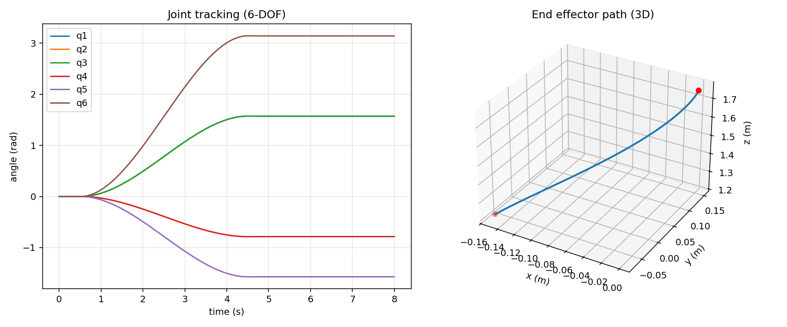
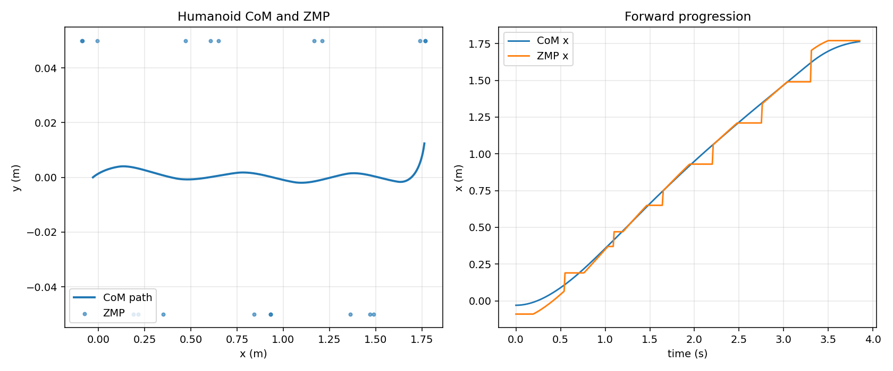
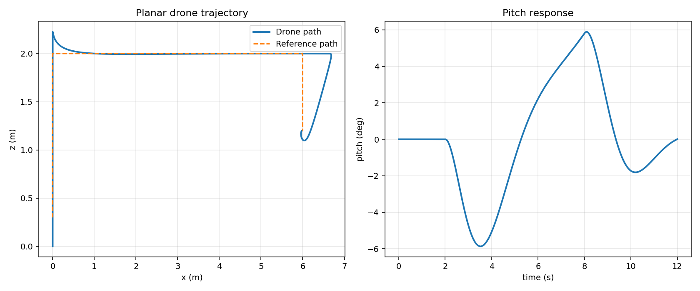
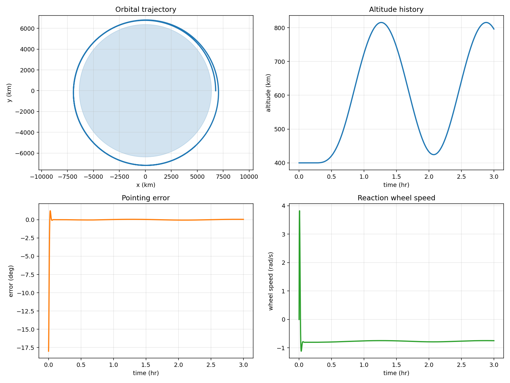

# Dynamics Simulation Lab

차량, 매니퓰레이터, 휴머노이드뿐 아니라 드론과 위성까지 확장한 동역학 학습용 저장소다. 복잡한 프레임워크 없이 바로 실행할 수 있게 구성했고, 각 시뮬레이션은 `outputs/`에 CSV 결과를 남긴다.

## 포함된 시뮬레이션

- `src/dynamicslab/vehicle.py`: preview path tracking, steering actuator, tire saturation을 포함한 dynamic bicycle vehicle 시뮬레이션
- `src/dynamicslab/vehicle_models.py`: kinematic bicycle, Ackermann, double-track, skid-steer, articulated, drift, off-road, full vehicle 모델 모음
- `src/dynamicslab/manipulator.py`: 2-link planar manipulator rigid-body dynamics와 PD + gravity compensation 제어
- `src/dynamicslab/humanoid.py`: LIPM-inspired 휴머노이드 CoM / ZMP 보행 시뮬레이션
- `src/dynamicslab/drone.py`: 2D quadrotor dynamics와 waypoint tracking 시뮬레이션
- `src/dynamicslab/satellite.py`: 2D two-body orbital dynamics, attitude tracking, reaction wheel 제어를 포함한 위성 시뮬레이션
- `examples/drone_mission_demo.py`: 이륙, 전진, 착륙 구간을 포함한 드론 미션 예제
- `examples/satellite_orbit_demo.py`: reaction wheel로 자세를 맞추며 저추력 궤도 에너지를 올리는 위성 예제
- `examples/vehicle_lane_change_demo.py`: dynamic bicycle 차량 궤적과 steering 입력 예제
- `examples/vehicle_model_suite_demo.py`: 다양한 차량 모델을 일괄 실행해 CSV를 생성하는 예제
- `examples/manipulator_tracking_demo.py`: 조인트 추종과 end-effector 궤적 예제
- `examples/humanoid_walk_demo.py`: 발 디딤 계획에 따른 CoM 진행 예제
- `simulations/run_all.py`: 모든 데모 일괄 실행
- `tests/test_dynamics.py`: 기본 동작 검증

## 빠른 실행

```bash
python3 examples/vehicle_lane_change_demo.py
python3 examples/vehicle_model_suite_demo.py
python3 examples/manipulator_tracking_demo.py
python3 examples/humanoid_walk_demo.py
python3 examples/drone_mission_demo.py
python3 examples/satellite_orbit_demo.py
python3 simulations/run_all.py
python3 -m unittest discover -s tests -v
```

선택적으로 플롯까지 저장하려면:

```bash
python3 -m pip install '.[plot]'
```

`matplotlib`가 설치되어 있으면 각 데모가 PNG 플롯도 함께 저장한다.

MATLAB 플롯 이미지도 같은 방식으로 `outputs/` 아래에 `png`, `jpg`, `svg`로 저장한 뒤 README에 상대경로로 넣을 수 있다.

```matlab
exportgraphics(gcf, 'outputs/vehicle_lane_change.png', 'Resolution', 200);
```

```md

```

## 모델 개요

### 1. Vehicle Dynamics

차량은 한 가지 모델만 두지 않고, 구조와 정밀도에 따라 여러 계층으로 나눴다.

- 구조 기준: Ackermann steering, skid-steer, articulated vehicle
- 정밀도 기준: kinematic bicycle, dynamic bicycle, double-track, full vehicle
- 주행 regime 기준: drift / high-slip, off-road

기본 `vehicle.py`는 dynamic bicycle highway handling 예제를 제공하고, `vehicle_models.py`는 아래 모델군을 추가로 제공한다.

- `simulate_kinematic_bicycle_parking`: 저속 주차/플래닝용 kinematic bicycle
- `simulate_ackermann_steering_course`: 좌우 조향각 차이를 반영한 Ackermann steering course
- `simulate_vehicle_lane_change`: dynamic bicycle 기반 고속 lane change
- `simulate_double_track_obstacle_avoidance`: 좌우 바퀴 normal load와 tire force를 분리한 double-track
- `simulate_skid_steer_maneuver`: 좌우 구동력 차이로 회전하는 skid-steer
- `simulate_articulated_vehicle_s_curve`: tractor-trailer articulation이 나타나는 articulated vehicle
- `simulate_drift_transition`: rear traction saturation으로 sideslip이 커지는 drift / high-slip
- `simulate_offroad_traverse`: 지형 높이와 local friction 변화를 반영한 off-road traverse
- `simulate_full_vehicle_ride_and_handling`: roll, pitch, wheel rotation을 포함한 full vehicle approximation

- 상태: `x, y, yaw, vx, vy, yaw_rate, steering`
- 입력: steering command, longitudinal acceleration command
- 동역학: steering actuator, combined-slip lateral force saturation, drag, rolling resistance, longitudinal load transfer
- 제어기: preview-based lateral path tracking + speed tracking
- 시나리오: double lane change와 recovery maneuver를 포함한 highway handling sequence

결과는 `outputs/vehicle_lane_change.csv`에 저장된다.


### 2. Manipulator Dynamics

2-link planar manipulator의 rigid-body dynamics를 사용했다.

- 상태: `q1, q2, dq1, dq2`
- 동역학: 질량 행렬, 코리올리 항, 중력 항
- 제어기: PD + gravity compensation
- 시나리오: home pose에서 목표 joint configuration으로 smooth tracking

결과는 `outputs/manipulator_tracking.csv`에 저장된다.



### 3. Humanoid Dynamics

휴머노이드는 full-body multibody 대신 LIPM-inspired CoM model로 단순화했다.

- 상태: `com_x, com_y, com_vx, com_vy`
- 입력: support foot 내부로 clamp된 ZMP
- 계획: alternating footstep sequence
- 제어기: CoM reference를 추종하는 ZMP controller

결과는 `outputs/humanoid_walk.csv`에 저장된다.



### 4. Drone Dynamics

드론은 planar quadrotor model로 단순화했다.

- 상태: `x, z, vx, vz, theta, omega`
- 입력: collective thrust, pitch torque
- 제어기: outer-loop position tracking + inner-loop attitude stabilization
- 시나리오: 이륙 후 전진 비행, 고도 유지, 완만한 하강

결과는 `outputs/drone_mission.csv`에 저장된다.



### 5. Satellite Dynamics

위성은 planar two-body orbital model에 attitude dynamics와 reaction wheel actuator를 결합한 형태로 구성했다.

- 상태: `x, y, vx, vy, theta, omega, wheel_momentum`
- 입력: body-axis low thrust acceleration, reaction wheel torque
- 동역학: central gravity + finite burn + single-axis attitude dynamics
- 제어기: velocity direction을 추종하는 PD attitude controller
- 시나리오: 400 km 근방 원형 궤도에서 prograde pointing을 유지하며 에너지를 올려 더 높은 타원 궤도로 이동

결과는 `outputs/satellite_orbit_raise.csv`에 저장된다.



## 프로젝트 구조

```text
.
├── README.md
├── examples
│   ├── drone_mission_demo.py
│   ├── humanoid_walk_demo.py
│   ├── manipulator_tracking_demo.py
│   ├── satellite_orbit_demo.py
│   ├── vehicle_model_suite_demo.py
│   └── vehicle_lane_change_demo.py
├── outputs
├── pyproject.toml
├── simulations
│   └── run_all.py
├── src
│   └── dynamicslab
│       ├── __init__.py
│       ├── drone.py
│       ├── humanoid.py
│       ├── manipulator.py
│       ├── satellite.py
│       ├── utils.py
│       ├── vehicle.py
│       └── vehicle_models.py
└── tests
    └── test_dynamics.py
├── visualizer
│   ├── launch.py
│   ├── index.html
│   ├── app.js
│   └── models
│       ├── vehicle.js
│       ├── manipulator.js
│       ├── humanoid.js
│       ├── drone.js
│       └── satellite.js
```

## 3D 시각화

브라우저에서 시뮬레이션 결과를 3D 애니메이션으로 확인할 수 있다.

```bash
python3 visualizer/launch.py
```

`http://localhost:8765/visualizer/index.html`이 자동으로 열리며, 좌측 사이드바에서 시뮬레이션을 선택하고 재생할 수 있다. 카메라는 마우스로 자유롭게 조작할 수 있고, 재생 속도 조절과 프레임 스크러빙도 지원한다.

## 확장 아이디어

- nonlinear tire model과 combined slip vehicle dynamics
- inverse dynamics controller 또는 computed torque control
- full-body centroidal dynamics 혹은 MPC 기반 humanoid walking
- full 6-DoF quadrotor with motor mixing and wind disturbance
- notebook 기반 parameter sweep와 sensitivity analysis
