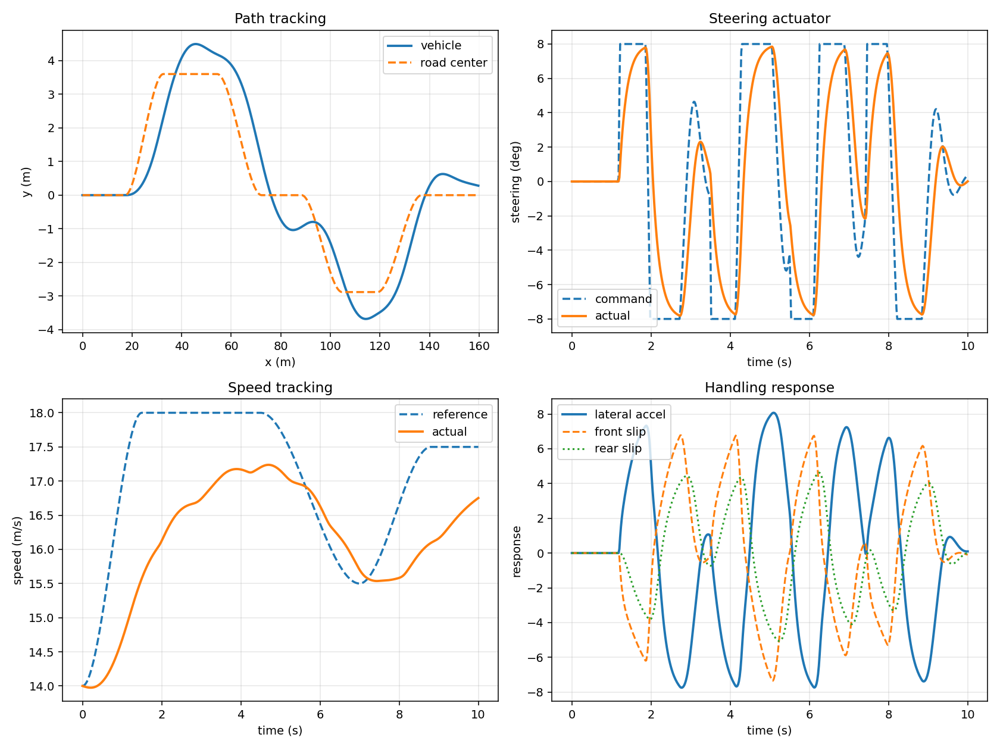

# Dynamics Simulation Lab

차량, 매니퓰레이터, 휴머노이드 계열의 대표적인 동역학 예제를 표준 라이브러리 중심으로 구현한 학습용 저장소다. 복잡한 프레임워크 없이 바로 실행할 수 있게 구성했고, 각 시뮬레이션은 `outputs/`에 CSV 결과를 남긴다.

## 포함된 시뮬레이션

- `src/dynamicslab/vehicle.py`: single-track bicycle vehicle dynamics와 lane change 시뮬레이션
- `src/dynamicslab/manipulator.py`: 2-link planar manipulator rigid-body dynamics와 PD + gravity compensation 제어
- `src/dynamicslab/humanoid.py`: LIPM-inspired 휴머노이드 CoM / ZMP 보행 시뮬레이션
- `examples/vehicle_lane_change_demo.py`: 차량 궤적과 steering 입력 예제
- `examples/manipulator_tracking_demo.py`: 조인트 추종과 end-effector 궤적 예제
- `examples/humanoid_walk_demo.py`: 발 디딤 계획에 따른 CoM 진행 예제
- `simulations/run_all.py`: 모든 데모 일괄 실행
- `tests/test_dynamics.py`: 기본 동작 검증

## 빠른 실행

```bash
python3 examples/vehicle_lane_change_demo.py
python3 examples/manipulator_tracking_demo.py
python3 examples/humanoid_walk_demo.py
python3 simulations/run_all.py
python3 -m unittest discover -s tests -v
```

선택적으로 플롯까지 저장하려면:

```bash
python3 -m pip install '.[plot]'
```

`matplotlib`가 설치되어 있으면 각 데모가 PNG 플롯도 함께 저장한다.

## 모델 개요

### 1. Vehicle Dynamics

차량은 single-track bicycle model로 표현했다.

- 상태: `x, y, yaw, vx, vy, yaw_rate`
- 입력: steering angle, longitudinal acceleration
- 힘 모델: front/rear tire cornering stiffness, drag, rolling resistance
- 시나리오: steering pulse를 이용한 lane change

결과는 `outputs/vehicle_lane_change.csv`에 저장된다.



### 2. Manipulator Dynamics

2-link planar manipulator의 rigid-body dynamics를 사용했다.

- 상태: `q1, q2, dq1, dq2`
- 동역학: 질량 행렬, 코리올리 항, 중력 항
- 제어기: PD + gravity compensation
- 시나리오: home pose에서 목표 joint configuration으로 smooth tracking

결과는 `outputs/manipulator_tracking.csv`에 저장된다.


### 3. Humanoid Dynamics

휴머노이드는 full-body multibody 대신 LIPM-inspired CoM model로 단순화했다.

- 상태: `com_x, com_y, com_vx, com_vy`
- 입력: support foot 내부로 clamp된 ZMP
- 계획: alternating footstep sequence
- 제어기: CoM reference를 추종하는 ZMP controller

결과는 `outputs/humanoid_walk.csv`에 저장된다.


## 프로젝트 구조

```text
.
├── README.md
├── examples
│   ├── humanoid_walk_demo.py
│   ├── manipulator_tracking_demo.py
│   └── vehicle_lane_change_demo.py
├── outputs
├── pyproject.toml
├── simulations
│   └── run_all.py
├── src
│   └── dynamicslab
│       ├── __init__.py
│       ├── humanoid.py
│       ├── manipulator.py
│       ├── utils.py
│       └── vehicle.py
└── tests
    └── test_dynamics.py
```

## 확장 아이디어

- nonlinear tire model과 combined slip vehicle dynamics
- inverse dynamics controller 또는 computed torque control
- full-body centroidal dynamics 혹은 MPC 기반 humanoid walking
- notebook 기반 parameter sweep와 sensitivity analysis
